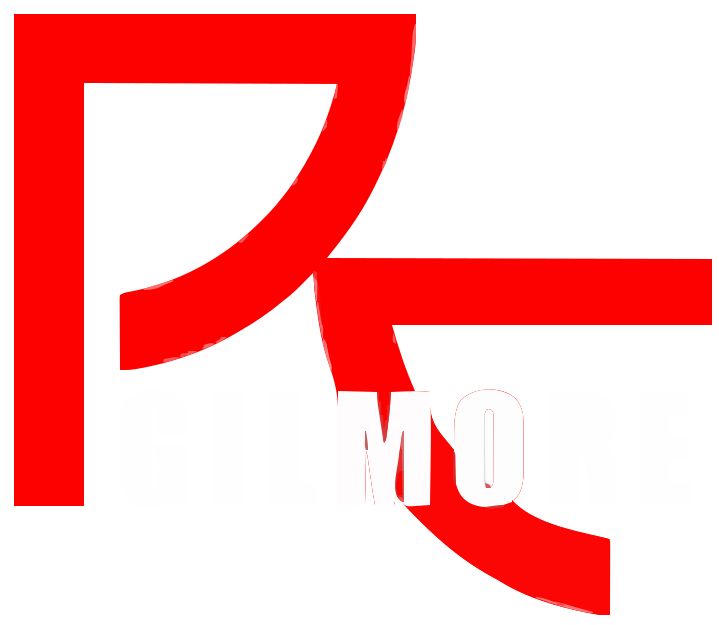

<div align="center">

  

  <h1>Phone Gilmore</h1>

  <p><em>Retail phones, trusted service — your local smartphone shop near Gilmore, Quezon City.</em></p>

  <p>
    <a href="https://jemmy09.github.io/glmr/">
      
    </a>
    <a href="https://github.com/Jemmy09/glmr">
      
    </a>
    
    
  </p>
  <p>
    
    
    
    <a href="LICENSE">
      
    </a>
  </p>

</div>

---

## Overview

**Phone Gilmore** is a fast, conversion-focused retail landing page designed for a local smartphone and repair store in Quezon City, Philippines. Inspired by leading Philippine tech retailers, the interface combines a clean light-mode catalog with instant client-side search, multi-brand filtering, an interactive store gallery, and one-click customer inquiry modals—all with **zero external JavaScript frameworks or build steps**.

---

## Tech Stack

| Layer | Technology | Purpose |
| :--- | :--- | :--- |
| **Structure & SEO** | **HTML5 + Schema.org JSON-LD** | Semantic landmarks, Open Graph metadata, and `MobilePhoneStore` local business structured data |
| **Styling & Layout** | **Modern CSS3** | Custom properties (`:root` tokens), CSS Grid & Flexbox, responsive breakpoints, and `prefers-reduced-motion` / `prefers-contrast` support |
| **Interactivity** | **Vanilla JavaScript (ES6+)** | Combined search + brand filtering, accessible focus-trapped modal dialog, active section observer, and infinite-loop carousel |
| **Typography & Media** | **Inter (Google Fonts) + Inline SVG** | Crisp UI typography and zero-dependency vector icons |
| **Location & Hosting** | **Google Maps Embed + GitHub Pages** | Interactive store directions and fast static hosting |

---

## Key Features

- **Retail-First UI/UX:** Top announcement bar with store hours and direct phone/social links, sticky search-first header, promotional hero banner, trust strip, and quick category tiles.
- **24 Smartphones Across 14 Brands:** Curated catalog with Philippine `₱` pricing, hardware specifications, and local studio product imagery covering **Apple, Samsung, Google, Xiaomi, Huawei, OPPO, Infinix, realme, vivo, TECNO, HONOR, Motorola, OnePlus, and Nokia**.
- **Real-Time Search & Brand Filter Tabs:** Instant keyword search bar and brand filter pills (`All` + 14 brands) that filter the product grid simultaneously with live `aria-live` status updates.
- **Accessible Inquiry Modal:** Keyboard-friendly modal (`role="dialog"`, `Tab` / `Shift+Tab` focus trap, `Escape` close, and focus restoration) for product inquiries, pre-owned checks, and accessories.
- **Infinite-Loop Store Gallery:** Touch- and keyboard-friendly image carousel with previous/next controls, slide indicators, and automatic pause on hover, focus, or backgrounded browser tabs.

---

## Project Structure

```text
PhoneGilmore/
├── index.html          # Main landing page markup, SEO meta tags & JSON-LD schema
├── css/
│   └── style.css       # Design tokens, retail layout, responsive grid & modal styles
├── js/
│   └── app.js          # Search/brand filter logic, modal focus trap & gallery carousel
├── assets/
│   ├── logo.svg        # Phone Gilmore vector brand logo
│   └── images/         # Hero banner, 8 store gallery photos & 24 phone product images
├── LICENSE             # MIT License
└── README.md           # Project documentation
```

---

## Getting Started

No package managers or build tools are required:

```bash
# 1. Clone the repository
git clone https://github.com/Jemmy09/glmr.git

# 2. Enter the project folder
cd glmr

# 3. Open index.html in your browser (or launch with VS Code Live Server)
```

---

## Store & Contact Information

- **Address:** 19-21 1st Street, Near Gilmore Avenue, Barangay Valencia, Quezon City, 1112
- **Business Hours:** Monday – Saturday, 09:00 AM – 06:00 PM
- **Contact Numbers:** `+63 968 144 7979` · `+63 908 812 7088` · `+63 968 163 7979` · `(02) 8 721 3496`
- **Email:** [pcgilmoresales@gmail.com](mailto:pcgilmoresales@gmail.com)
- **Social & Marketplace:** [Facebook (@pcgilmoreph)](https://www.facebook.com/pcgilmoreph) · [Shopee (Shop ID: 1700377019)](https://shopee.ph/shop/1700377019)

---

<div align="center">
  <sub>&copy; 2026 Phone Gilmore. Released under the <a href="LICENSE">MIT License</a>.</sub>
</div>
